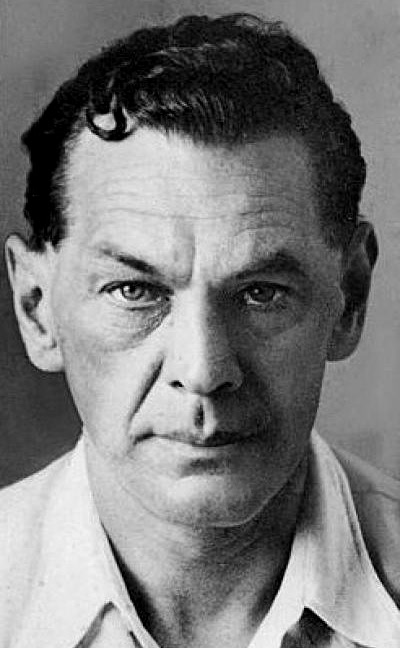
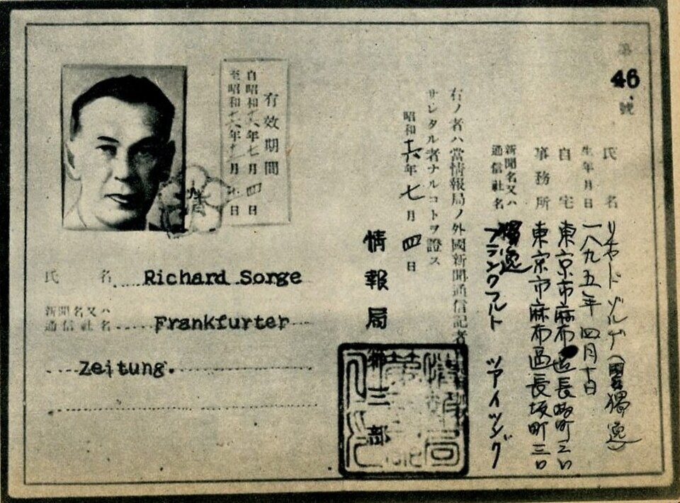
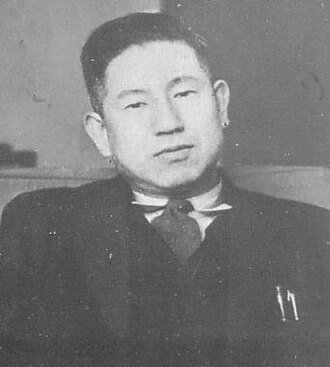
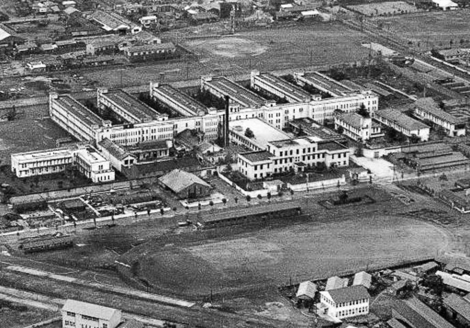
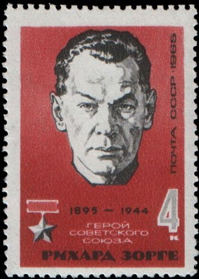

# The Spy Moscow Disowned

*Preview line: Richard Sorge warned Stalin that Germany would invade, and was ignored. Then he told Moscow that Japan would not attack, and was believed. On 7 November 1944 Japan hanged him, and for twenty years the country he served would not admit he had been its spy.*

*Richard Sorge, about 1941. Unknown photographer, public domain.*

On the morning of 7 November 1944, the anniversary of the Russian Revolution, the governor of Sugamo Prison in Tokyo and a Buddhist chaplain walked a German prisoner to the gallows. The trap fell at 10:20. Earlier that same day, in the same prison, the Japanese had hanged the man who had been his best source.

The prisoner was Richard Sorge. For eight years he had lived in Tokyo as a respected German newspaperman and a member of the Nazi Party, and he had worked from an office inside the German embassy. All that time he had been spying for the Soviet Union, and he had sent Moscow some of the most important intelligence of the war.

Moscow would not say his name for another twenty years.

## A soldier turns

Sorge was born on 4 October 1895 in Sabunchi, an oil settlement outside Baku in the Russian Empire, in what is now Azerbaijan. His father was a German oil engineer and his mother, Nina, was Russian. The family moved to Germany while he was small, and he grew up in the Berlin suburb of Lichterfelde.

In October 1914 he enlisted in the German army. He was wounded more than once, and the wounds left him with a permanent limp; the sources disagree on exactly where and when. In hospital a nurse brought him Marx. He came out a communist. He joined the German Communist Party in 1919, the year he took his doctorate in Hamburg, and in 1924 he moved to Moscow to work for the Communist International.

In 1929 he joined the Red Army's Fourth Department, the military intelligence service later known as the GRU. It sent him to Shanghai in 1930, and to Tokyo in 1933.

## The perfect cover

Sorge reached Japan in September 1933 as the correspondent of the Frankfurter Zeitung, the most respected paper in Germany. He also carried a Nazi Party card. The sources differ on whether he joined in Berlin in 1933 or in Tokyo in 1934 on Soviet advice, but either way he may have been the only man ever to belong to the Soviet Communist Party and the Nazi Party at the same time.

*Sorge's Japanese foreign correspondent pass for the Frankfurter Zeitung, issued by the Cabinet Information Bureau on 4 July 1941, months before his arrest. Public domain.*

His task was simple to state and hard to do: find out whether Japan meant to attack the Soviet Union.

He built a ring to answer it. His star recruit was Ozaki Hotsumi, an Asahi Shimbun journalist and China expert who sat in the circle around Prime Minister Konoe Fumimaro and gave Sorge a view into the highest levels of the Japanese government. Miyagi Yotoku, an Okinawan painter, worked under Ozaki. Branko Vukelić, a Croatian photo reporter who came to Tokyo in 1933, joined too. From 1935 Max Clausen, a German communist, worked the radio, sending the ring's messages to Moscow in a numerical code built on one time pads. Japanese monitors could hear the signals. They never broke them.

*Ozaki Hotsumi, the Asahi Shimbun journalist in Prince Konoe's circle who was Sorge's best source, in the prewar Showa years. Unknown photographer, public domain.*

Sorge's closest German contact was Eugen Ott, who came to Tokyo as military attaché and became ambassador in 1938. Ott leaned on Sorge's knowledge of Japan, and Sorge helped write his reports to Berlin. As the writer Neal Ascherson put it in 1966, "By the time of his arrest Sorge had an office within the Embassy, and was constantly shown secret documents and telegrams."

## The warning nobody wanted

Sorge's first serious warning that Germany might attack the Soviet Union went out on 28 December 1940. Moscow's readers marked one of his reports from that month as doubtful, though they still sent it on to Stalin.

On 30 May 1941 he radioed: "Berlin informed Ott that German attack will commence in the latter part of June." On 1 June he passed on word from a visiting German officer, Lieutenant Colonel Erwin Scholl, that 170 to 190 divisions were massed on the border. The note on that dispatch in Moscow read: "Suspicious. To be listed with telegrams intended as provocations."

Whether he ever named the exact day is still argued. Some accounts say he did; the historian Gordon Prange concluded the closest he came was 20 June. The result is not in doubt. Stalin ignored the warnings, and is reported to have dismissed Sorge in crude terms as a man who had set himself up with factories and brothels in Japan. On 22 June 1941, Germany invaded.

## Short trousers

Now Sorge's original question mattered more than ever. With German armies driving east, would Japan strike the Soviet Union from behind?

On 23 August 1941 he reported a small, telling detail: "Many Japanese soldiers are being issued short trousers." Those were uniforms for the tropics, not for Siberia. Two days later, through Ozaki, he reported that the high command had decided not to go to war with the Soviet Union that year.

On 6 September an Imperial Conference in Tokyo decided to prepare for war with the United States, Britain, and the Netherlands. On 14 September Sorge told Moscow that "the possibility of [Japan] launching an attack, which existed until recently, has disappeared." On 4 October, in the last message he ever sent, he reported that it was certain Japan would not invade that year.

This time Moscow could use what he sent. As the Germans closed on the capital, the Soviets drew on their Far Eastern armies. Accounts of the numbers vary. One counts 15 infantry divisions, 3 cavalry divisions, 1,700 tanks and 1,500 aircraft moved west in the two months after mid September; another says Stalin shifted over half the available Siberian troops.

How much of the credit belongs to Sorge is debated. A CIA reviewer wrote that Stalin "did accept his report that the Japanese would go South rather than attack the Soviet Union." Japan's National Institute for Defense Studies is more cautious. It says the claims for the ring carry strong mythological elements from the Cold War, and that Soviet intelligence weighed his reports against other sources and never lowered its guard against Japan. One later legend, that he warned Moscow about Pearl Harbor, has no support in the record at all.

## The arrests

The ring was already fraying. Clausen, losing faith, had been cutting or holding back some of Sorge's reports without telling him. In October 1941 the police closed in. Miyagi was arrested first; he survived a jump from a window and, under interrogation, named Ozaki and Sorge. Ozaki was taken on 14 or 15 October.

On 18 October 1941 police arrested Sorge at his home. It was the same day General Tojo Hideki's cabinet took office. Clausen was arrested the same day, and in the end 35 people were arrested in the case.

In Sorge's house the police found a last message that was never sent. It predicted war with the United States within a month or two, and it closed with a line that reads now like a farewell: "We [Sorge and Clausen] are watching with deep sympathy the heroic war you are waging against Germany, and we greatly regret that we are here, where we are of no interest or importance to you."

After resisting for about a week, Sorge talked. He gave a full account of his work on one condition: that his Japanese companion, Ishii Hanako, and the wives of his colleagues would not be prosecuted. Ishii was never charged. To his investigating magistrate he insisted, "But my purpose was to keep the peace between Japan and the Soviet Union."

His arrest ended Ott's career in Tokyo. Ott was replaced as ambassador and spent the rest of the war in Peking.

## "Unknown to us"

The Tokyo District Court sentenced Sorge to death on 29 September 1943, and Ozaki was condemned too. Vukelić received a life sentence and died in Abashiri prison in Hokkaido in 1945. In the Soviet Union, the NKVD had already arrested Sorge's Russian wife, Katya Maximova, in September 1942. She died in a labor camp about a year later.

By one account, Japan offered three times to trade Sorge, and Moscow answered: "The man called Richard Sorge is unknown to us." A more recent study found no sign that Stalin ever tried to bargain for him. Either way, nobody came for him.

So on 7 November 1944 he went to the gallows at Sugamo, a few hours after Ozaki. Wartime fuel shortages meant his body was not cremated. He was buried in a common plot for the prison's inmates.

*Sugamo Prison in Tokyo from the air in 1949, five years after Sorge and Ozaki were hanged there. Unknown photographer, public domain.*

## The woman who kept his grave

Someone did come, in the end. Ishii Hanako had been a waitress at one of his regular bars. She began living with him in 1936 and was his companion for nearly six years.

After the war she found his remains, identified by his dental work and a badly set leg, and paid to move them to Tama Cemetery in western Tokyo, in 1949 or 1950 by the different accounts. His stone there carries the words Hero of the Soviet Union in Russian. Beneath his name is hers, in Japanese. She tended the grave until she died in 2000, at 89.

The title on that stone came late. For twenty years Moscow denied that Sorge had been its spy. Then a Pravda article on 4 September 1964 began his rehabilitation, helped along by a 1961 French and Japanese film about him that Nikita Khrushchev had seen. A decree of 5 November 1964 made him a Hero of the Soviet Union, twenty years after his death; Japan's defense institute calls him the first person outside the military to receive it. In January 1965 Clausen, by then living in East Germany, received the Order of the Red Banner. Vukelić was honored after his death. Early in 1965 the Soviet Union put Sorge's face on a postage stamp.

*The Soviet stamp of 1965 honoring Richard Sorge, issued months after he was named a Hero of the Soviet Union. USSR postal administration, public domain.*

The country he spied for took twenty years to say his name. A Tokyo waitress kept it on his grave for half a century.

---

## Also this week

Each morning brought a new dispatch. Catch up on any you missed:

**No. 031 · Marines storm Cape Torokina**, 1 November 1943 · [Read on X](https://x.com/ww2dispatches/status/2116908548990837169)

**No. 033 · Supercharge breaks Rommel**, 2 November 1942 · [Read on X](https://x.com/ww2dispatches/status/2117271745753129048)

**No. 035 · Paper bombs ride the jet stream**, 3 November 1944 · [Read on X](https://x.com/ww2dispatches/status/2117633937287622791)

**No. 037 · Rommel retreats from Alamein**, 4 November 1942 · [Read on X](https://x.com/ww2dispatches/status/2117996447995965825)

**No. 039 · Carriers strike Manila Bay**, 5 November 1944 · [Read on X](https://x.com/ww2dispatches/status/2118359096298459314)

**No. 041 · The ship that lied**, 6 November 1941 · [Read on X](https://x.com/ww2dispatches/status/2118721328123445549)

**No. 043 · Roosevelt wins a fourth term**, 7 November 1944 · [Read on X](https://x.com/ww2dispatches)

---

## Sources

[New Light on Old Spies: A Review of Recent Soviet Intelligence Revelations](https://www.cia.gov/resources/csi/static/Recent-Soviet-Intelligence-Revelations.pdf) and [Intelligence Officer's Bookshelf, Studies in Intelligence Vol. 63, No. 3](https://www.cia.gov/resources/csi/static/Intel-Officers-Bookshelf-63.3.pdf), CIA Center for the Study of Intelligence

[Richard Sorge and the Japanese attack on Pearl Harbor in 1941](https://www.nids.mod.go.jp/english/publication/commentary/pdf/commentary249e.pdf), National Institute for Defense Studies, Japan Ministry of Defense

[Sorge, Richard](https://www.deutsche-biographie.de/sfz74845.html), Neue Deutsche Biographie

[The Spy Who Saved the Soviets](https://www.historynet.com/the-spy-who-saved-the-soviets/), HistoryNet

[Master Spy](https://www.nybooks.com/articles/1966/05/12/master-spy/), The New York Review of Books

[Tokyo Espionage: Legendary Soviet Spy Richard Sorge](https://www.nippon.com/en/nipponblog/m00143/) and [A Fresh Look at a Legendary Spy](https://www.nippon.com/en/japan-topics/bg900461/), Nippon.com

[Impeccable Spy: Richard Sorge, Stalin's Master Agent](https://www.fccj.or.jp/number-1-shimbun-article/impeccable-spy-richard-sorge-stalins-master-agent), Number 1 Shimbun, Foreign Correspondents' Club of Japan

[Richard Sorge](https://www.britannica.com/biography/Richard-Sorge), Encyclopaedia Britannica

[Richard Sorge](https://en.wikipedia.org/wiki/Richard_Sorge) and [Hotsumi Ozaki](https://en.wikipedia.org/wiki/Hotsumi_Ozaki), Wikipedia

---

Thank you for reading the Weekly Dispatch. Every Sunday we pick the most remarkable story from the week's dates and tell it in full. Next week brings the anniversaries of Operation Torch and the sinking of the Tirpitz.

**One more thing.** On Veterans Day, Wednesday 11 November, we open **Declass**, a free card collecting game built from these dispatches. Every story we post becomes a card you can collect, in finishes from Copper to Top Secret, and your first pack of five is free. It opens at [ww2dispatches.com/declass](https://ww2dispatches.com/declass).

*WW2 Dispatches*
