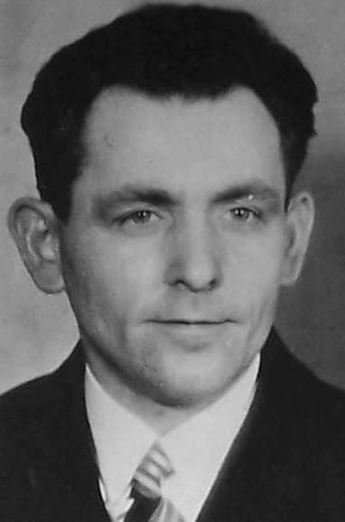
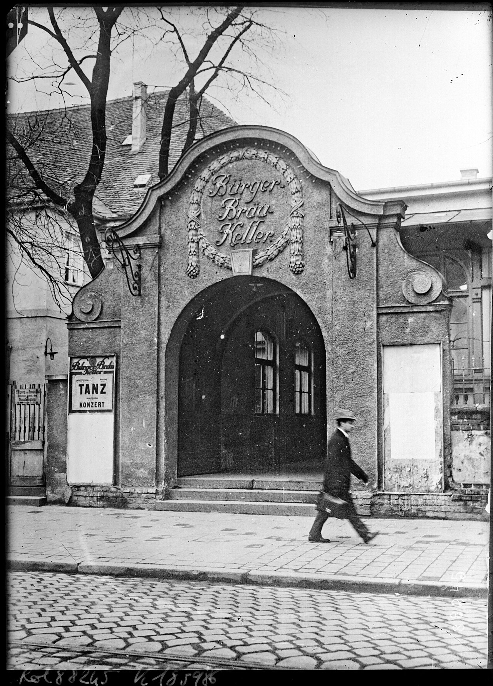
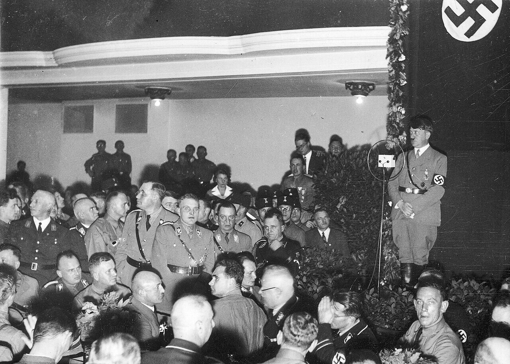
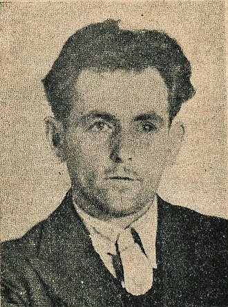

# Thirteen Minutes in Munich

*Preview line: A quiet carpenter spent more than thirty nights alone inside a Munich beer hall, hollowing out the pillar behind Hitler's lectern. On 8 November 1939 his bomb went off just as he had planned. Hitler had walked out thirteen minutes earlier.*

*Georg Elser, the carpenter from Königsbronn, in a portrait kept in his Gestapo file, taken before December 1939. Landesarchiv Nordrhein Westfalen, RW 58 Nr. 65209, public domain.*

At about a quarter to nine on the evening of 8 November 1939, two customs officers in Konstanz stopped a man near the Swiss border. He had paused to listen to a radio. Hitler was speaking in Munich at the yearly anniversary of his failed putsch of 1923, in the Bürgerbräukeller, the beer hall where it had begun.

In the man's pockets were a picture postcard of the Bürgerbräukeller, a badge of the Communist Red Front, notes on munitions production, parts of a detonator, and only a few marks. The officers did not yet know what any of it meant.

About half an hour later, at roughly 9:20, a bomb tore apart the pillar behind Hitler's lectern and brought the ceiling down onto the spot where he had stood. Hitler was gone. He had stopped speaking at 9:07, far earlier than usual, and hurried off to catch his train.

The man at the border was Georg Elser, a carpenter of 36. He had built the bomb, hidden it, and set its clocks, entirely alone.

## A carpenter from Königsbronn

Elser was born on 4 January 1903 in Hermaringen in Württemberg and grew up in nearby Königsbronn, the eldest child of a farmer and timber dealer, Ludwig Elser. His father drank, the family slid into poverty, and Georg had to look after his five younger brothers and sisters early.

He gave up an apprenticeship at the local ironworks for health reasons and trained as a carpenter instead, passing his journeyman's exam as the best of his year. From 1925 he spent about seven years working around Lake Constance, in Germany and Switzerland, including a spell making clock cases at a clock factory in Konstanz. He was quiet but sociable. He played the zither and the double bass at local dances and liked to hike, and in 1930 his girlfriend, Mathilde Niedermann, gave birth to his only son, Manfred.

He leaned left. He joined the Red Front Fighters' League, the Communist Party's paramilitary arm, in 1928 or 1929, though he was never active in it, and he voted Communist until 1933. He rejected Nazism from the start. He would not give the Hitler salute, and he walked away when Hitler's speeches came on the radio.

His anger was practical, and he could put numbers to it. In 1929, he later told his interrogators, a carpenter earned 1 Reichsmark an hour. Now he earned 68 pfennigs, while the deductions from that smaller wage had grown.

## The decision

In the autumn of 1938, as Europe passed through the Sudeten crisis and the Munich Agreement, Elser concluded that war was coming. He became convinced, as he put it later, "that Germany will make still further demands on other countries and annex other countries, and that a war is therefore unavoidable."

He decided to kill the three men he blamed: Hitler, Göring and Goebbels. "I also wanted to prevent by my act even greater bloodshed," he said.

On 8 November 1938 he travelled to Munich for the yearly anniversary of the putsch. After Hitler's speech he walked into the Bürgerbräukeller hall, looked at the lectern, and found that anyone could come in and nobody guarded it. The next evening he watched the Nazi leaders' memorial march, the same evening Goebbels's speech set off the Kristallnacht pogroms. He went home determined to put a bomb in that hall.

*The street entrance of the Bürgerbräukeller on Rosenheimer Strasse, Munich, in November 1923. Elser walked in through this main entrance on many nights in 1939. Agence Rol, Bibliothèque nationale de France, public domain.*

## Gathering the means

He began to collect what he needed. At the Waldenmaier fittings factory in Heidenheim, where he worked until March 1939, he stole 250 pressed black powder pellets and hid them in his wardrobe at home. At Easter he went back to Munich, measured the pillar behind the lectern, and sketched it.

From April he worked at the Vollmer quarry in Königsbronn, where he stole more than 100 explosive charges and over 125 detonators. After an accident at work in May he gave all his time to the plan, and in July he tested detonators in his parents' orchard.

In August 1939 he moved to Munich. From 1 September he rented a back room from Alfons and Rosa Lehmann at Türkenstrasse 94, for just under 4 marks a week.

## Thirty nights in the hall

Then came the work that makes his story so hard to believe. Each evening he ate a simple supper in the beer hall between 8 and 10, climbed to the gallery, and hid until the hall was locked. He worked until 2 or 3 in the morning, dozed in his hiding place, and slipped out the back to Kellerstrasse when the day began.

By his own account he spent 30 to 35 nights inside the hall. He cut a hidden door, about 80 centimeters square, into the wooden paneling of the pillar. He wrapped his tools in rags to deaden the noise and worked by a shaded flashlight. He lined the little door with sheet iron 2 mm thick, so that a nail or a knock would not give the hollow away. The rubble went into a sack, then out in a small suitcase, and into the river Isar. By the end of October the pillar was hollow.

The kneeling cost him. In early October his right knee was so badly inflamed that he was bedridden, and Rosa Lehmann brought him his meals. It was a detail that would later betray him.

*Hitler at the microphone in the Bürgerbräukeller hall at the putsch anniversary of 8 November 1933. The gallery where Elser later hid each night runs above the crowd. National Digital Archives of Poland, public domain.*

The bomb was the work of a carpenter who had once made clock cases. Two clock mechanisms could be set up to six days ahead and kept time to within fifteen minutes. When they ran down, they released a sliding block that drove nails onto rifle cartridges and fired the charge.

On the night of 2 November he loaded the explosives into the pillar. After one failed try, he fitted the clockwork after midnight on 5 November, following a dance in the hall, and by 6 a.m. on 6 November it was set for the evening of 8 November. He would, in his own words, "thereby let the matter take its course."

He took his belongings to his sister, Marie Hirth, in Stuttgart, telling her only that he had to go over the fence. On the night of 7 November he went back to the empty hall one last time. "I went in through the main entrance on Rosenheimerstrasse, through the cloakroom into the hall, which was empty and unlit," he said later. "I saw nobody." The clocks were running.

## Thirteen minutes

Hitler had not meant to come that year. With the attack in the West pending, he planned to send Rudolf Hess, and he decided only late on 7 November to speak after all.

He began at 8:10 p.m. on 8 November. At 9:07, much earlier than in past years, he stopped. He was hurrying to his special train to Berlin, which left Munich at 9:31.

At about 9:20 the bomb went off. It shattered the pillar and brought down the ceiling. Where the lectern had stood lay a pile of rubble a meter high. Eight people died, seven party members and a waitress, Maria Henle, and 63 were injured, by the count of the German Federal Archives. Seven died that night; the eighth, Michael Schmeidl, died on 13 November.

## "And who is behind it?"

In Konstanz, once news of the blast arrived, the things in Elser's pockets looked very different. He was taken to Munich and beaten repeatedly. Then the investigator Franz Josef Huber learned that the bomber had worked kneeling, and confronted him with his knee. On the night of 13 to 14 November Elser made a full confession.

The regime could not accept the answer. When Huber phoned the Gestapo chief, Heinrich Müller, with the confession, Müller's first question, as Huber recalled it, was "And who is behind it?" Heinrich Himmler, according to Huber, wrote across the report that found Elser had acted alone, in green pencil: "Which idiot wrote this report?"

*The Gestapo photo of Elser released to the press in November 1939, after his capture. For decades it was the image of him the world knew. Landesarchiv Nordrhein Westfalen, RW 58 Nr. 65209, public domain.*

Propaganda blamed British intelligence and Otto Strasser, and tied the bombing to two British agents, Sigismund Payne Best and Richard Stevens, kidnapped at Venlo on 9 November, who had nothing to do with it. Many in the German opposition, and most British and American newspapers, assumed the opposite: that the Nazis had staged it themselves, like the Reichstag fire.

Almost all of Elser's relatives were arrested, taken to Berlin, held at the Hotel Kaiserhof, and made to identify him while he still bore the marks of torture. The quarry owner he had stolen from spent more than a year in a concentration camp.

## Five years in a cell

Hitler wanted a show trial after victory, so Elser was kept alive as a special prisoner in the cell block at Sachsenhausen. He had a large cell and a workbench, and he built himself a zither. At least two SS guards watched him day and night, and for more than five years he had no contact with other prisoners.

Early in 1945, probably in February, he was moved to Dachau and kept in solitary confinement. On 5 April Müller wrote to the Dachau commandant. Elser, code named Eller, was to be killed quietly and his death blamed on an air raid. "I ask that Eller be liquidated in an absolutely inconspicuous way once such a situation arises," the letter said.

On 9 April 1945, SS Oberscharführer Theodor Bongartz shot Georg Elser near the old crematorium at Dachau. His body was burned at once. He has no grave. That same day Bonhoeffer, Canaris and others were murdered at Flossenbürg.

## The long road to honor

Even after the war, Elser was not believed. On 17 January 1946 Martin Niemöller claimed that he had been an SS man acting on Hitler's personal orders, and Payne Best told a similar story in 1950. Elser's mother fought these claims until her death in 1960. The family received no compensation.

The record that cleared him had been in the files all along. In 1964 the historian Lothar Gruchmann found the Gestapo interrogation record among the old Reich Justice Ministry papers, and Anton Hoch's study of 1969 showed that Elser had acted alone. In 1984 Chancellor Helmut Kohl honored him publicly. A plaque followed in Munich in 1989, a memorial center in Königsbronn in 1998, a stamp for his 100th birthday in 2003, and in 2011 a sculpture of his profile, 17 meters tall, in Berlin.

"Five years before Stauffenberg," the historian Peter Steinbach has said, "Elser came as close as imaginable to the goal of killing Hitler and so of working against the disaster of war that he clearly foresaw."

In Munich today, a neon memorial lights up every night at 9:20, for one minute.

---

## Also this week

Each morning brought a new dispatch. Catch up on any you missed:

ALSO_THIS_WEEK

---

## Sources

[The Georg Elser website](https://www.georg-elser.de/en/the-assassination-attempt-of-november-8-1939/the-assassination-attempt-of-november-8-1939), Gedenkstätte Deutscher Widerstand (German Resistance Memorial Center)

[Vernehmungsprotokoll des Georg Elser](https://www.bundesarchiv.de/themen-entdecken/online-entdecken/dokumente-zur-zeitgeschichte/vernehmungsprotokoll-des-georg-elser/), Bundesarchiv

[Anton Hoch, Das Attentat auf Hitler im Münchner Bürgerbräukeller 1939](https://www.ifz-muenchen.de/heftarchiv/1969_4.pdf), Vierteljahrshefte für Zeitgeschichte 17 (1969), Institut für Zeitgeschichte

[Wolfgang Benz, Elser, Georg](https://www.deutsche-biographie.de/gnd118530046.html), Neue Deutsche Biographie

[Johann Georg Elser](https://www.dhm.de/lemo/biografie/johann-georg-elser), Deutsches Historisches Museum, LeMO

[Georg Elser und sein Attentat vom 8. November 1939](https://www.lpb-bw.de/georg-elser-dossier), Landeszentrale für politische Bildung Baden Württemberg

[Georg Elser](https://en.wikipedia.org/wiki/Georg_Elser), Wikipedia

---

Thank you for reading the Weekly Dispatch. Every Sunday we pick the most remarkable story from the week's dates and tell it in full. Next week brings the anniversaries of the landing at Tarawa and the Soviet trap at Stalingrad.

*WW2 Dispatches*
