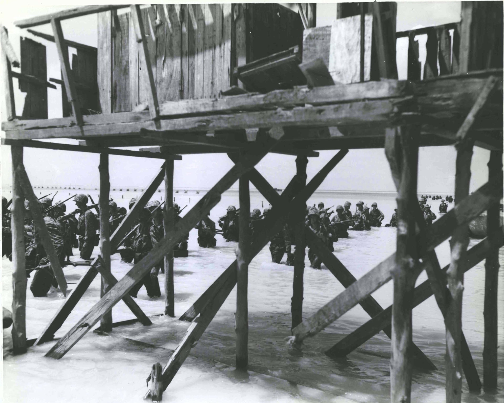
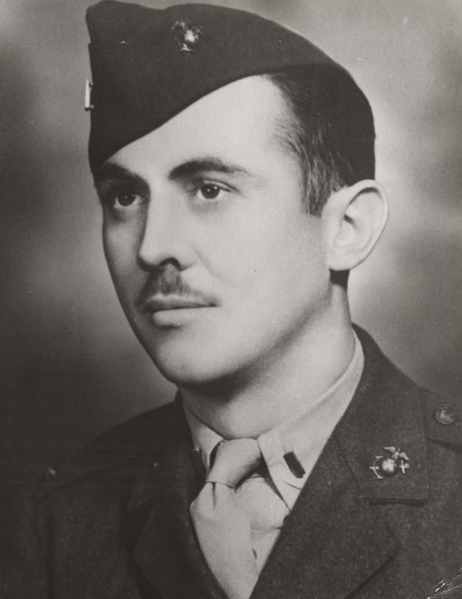
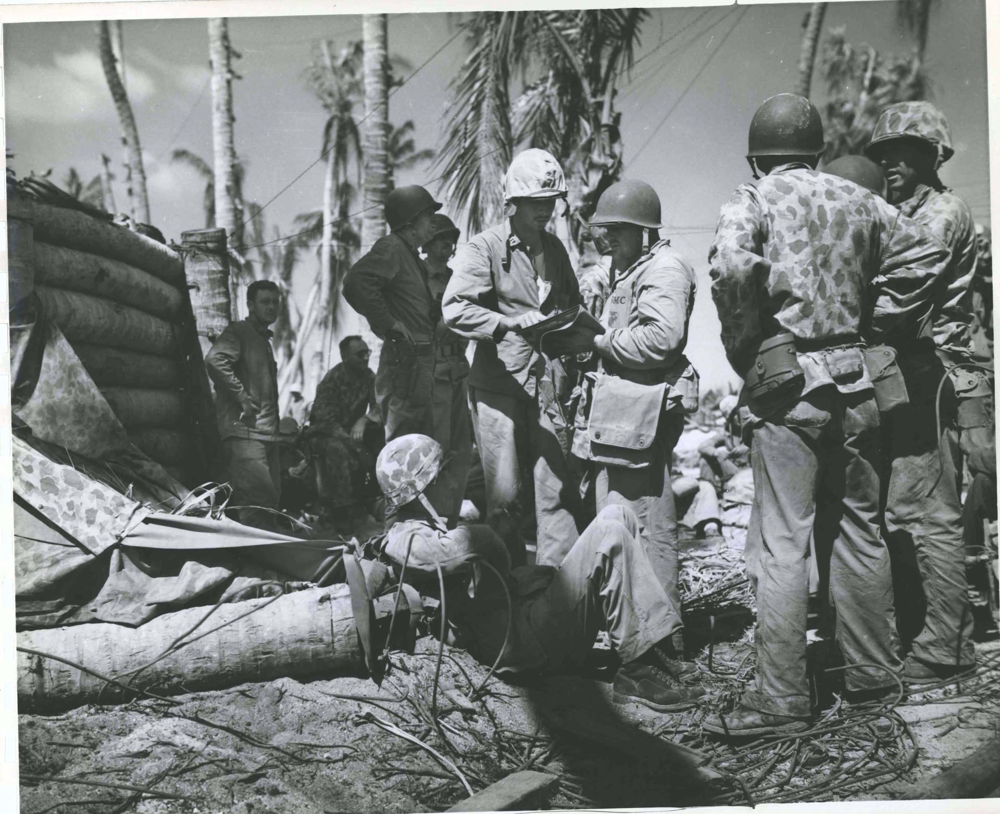
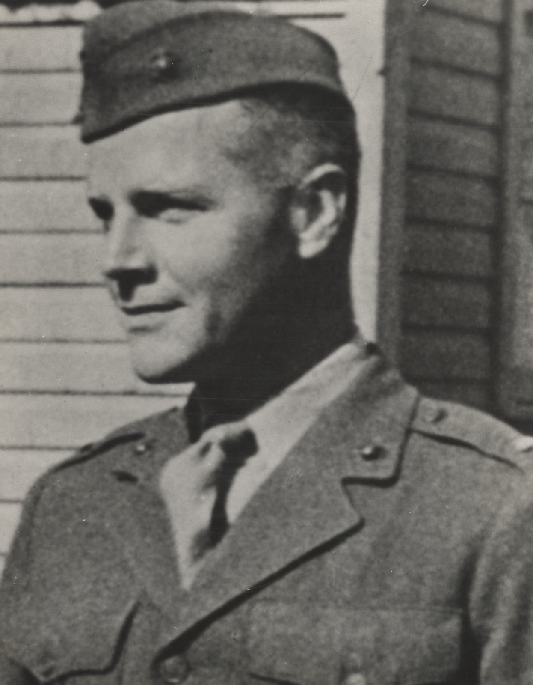
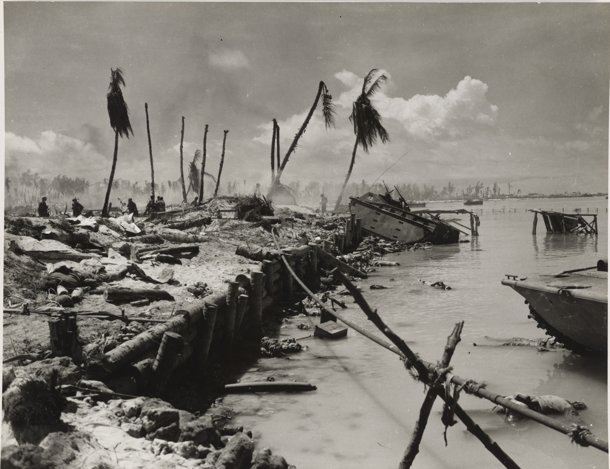

# The Tide That Never Came

*Preview line: A New Zealand officer who had lived beside Tarawa for fifteen years told the Marines there would not be three feet of water on the reef. On 20 November 1943 he was proved right, and thousands of men had to wade in under fire.*

*Marines wade toward Betio beside the long pier to reinforce those already ashore, November 1943. U.S. Navy, Record Group 38, National Archives 32606882, public domain.*

The water off Betio did not rise. All through the morning of 20 November 1943, landing boats full of Marines came in toward the little island of Betio and stopped dead on the coral, still hundreds of yards from the beach. The men climbed over the sides and began to walk.

One man in the planning rooms had told them it would happen. He was not a general or an admiral. He was a New Zealand reserve officer named Frank Holland, and he had spent fifteen years living on Bairiki, the island right next door, watching that reef.

## Four feet over the reef

Betio was the fortified heart of Tarawa, in the Gilbert Islands, and in Operation Galvanic it fell to the 2nd Marine Division under Maj. Gen. Julian C. Smith. Whatever way the Marines came in, every boat would have to cross a coral reef first.

The number that mattered was four feet. That was the depth needed over the reef to float a loaded Higgins boat. With less, the troops would have to get out and wade several hundred yards under fire.

The tide tables suggested Smith could expect about five feet of water at high neap tide. But he was also warned that the tides there were not dependable, and that dodging tides were frequent. Smith understood the danger from his own life. "I'm an old railbird shooter up on the marshes of the Chesapeake Bay," he recalled later. "You push over the marshes at high tide, and when you have a neap tide, you can't get over the marshes."

## The man who knew the tide

For tide information the division turned to men who had lived and sailed in the islands. Major Holland was one of them, and he did not hedge. "There won't be three feet of water on the reef!" he predicted.

Col. David M. Shoup took the warning seriously. He made sure the troops knew there was a 50 to 50 chance they would have to wade in.

Other decisions narrowed the margin further. At the planning conference at Pearl Harbor, Admiral Chester Nimitz limited the opening bombardment to about three hours on the morning of D Day, for the sake of surprise, and ruled out taking Bairiki first or making a decoy landing. Then Maj. Gen. Holland Smith announced that the 6th Marines would be held back as corps reserve.

That left Julian Smith with only a two to one advantage in troops, below the minimum the doctrine called for. Shaken, he insisted that Holland Smith absolve him of responsibility for the consequences. It was done.

There was one answer to the reef. Amphibian tractors, the tracked amtracs, could climb over coral where boats could not. The division had about 100 of them, 75 thought fit for battle, and 50 new LVT 2s were rushed to Samoa to meet the fleet at Tarawa. The amtracs would carry the first three waves. Everyone after that would come in boats.

## Issue in doubt

Watching the bombardment that morning, Time correspondent Robert Sherrod thought that "surely, no mortal men could live through such destroying power." But for the final 25 minutes of the run in, the naval gunfire almost entirely lifted. The defenders used the pause to move men from the south and west beaches to the north shore, where the Marines were coming.

Just before H Hour, 1st Lt. William Deane Hawkins and his Scout Sniper Platoon, with a squad of engineers under Lt. A. G. Leslie, charged up the long pier that ran out to the edge of the reef. They burned and blasted its machine gun nests with explosives and flamethrowers, about 15 minutes before any troops reached the beach. Leslie's flamethrower set the pier itself on fire.

*1st Lt. William Deane Hawkins of El Paso, Texas, who led the Scout Sniper Platoon onto the pier and died on Betio. USMC photo, National Archives 127-GR-53-302947, public domain.*

The first amtracs touched down on Red Beach One at 9:10 a.m. The tractors did what they had been built for. Only 8 of the 87 in the first three waves were lost going in, and within about ten minutes they had landed more than 1,500 Marines.

Then the boats arrived, and Holland's prediction came true. No landing craft crossed the reef all day. After about 10 a.m. most of the troops had to wade from the reef edge, 500 to 1,000 yards, into well aimed fire.

Maj. Drewes, the amtrac battalion commander who had worked with Shoup to make the tractor assault possible, took over a machine gun from a fallen gunner and was killed instantly. At 9:59 a.m. Maj. Schoettel, off Red Beach One, radioed Shoup: "Receiving heavy fire all along beach. Unable to land all. Issue in doubt."

## Seven hundred yards

Sherrod went in with the fourth wave on Red Beach Two. "It was painfully slow, wading in such deep water," he wrote. "And we had seven hundred yards to walk slowly into that machine gun fire, looming into larger targets as we rose onto higher ground. I was scared, as I had never been scared before."

Shoup set up his command post on the blind side of a Japanese bunker that was still occupied. At least two dozen messengers were shot carrying dispatches to and from him. "We're in a tight spot," he told Sherrod. "We've got to have more men."

*Col. David Shoup (center, with map case) confers with Col. Merritt Edson (hands on hips) and Lt. Col. Evans Carlson (seated) outside the bombproof command post on Betio, November 1943. U.S. Navy, Record Group 38, National Archives 32606852, public domain.*

At 1:31 p.m. Julian Smith radioed Holland Smith "situation in doubt" and asked for the 6th Marines to be released to him.

SSgt. William Bordelon, a combat engineer, had seen his amtrac hit on the way in. He led the survivors ashore and knocked out positions with demolition charges. He went back into the water to save a wounded Marine, then was killed charging another strongpoint. He was the first of four Marines awarded the Medal of Honor for Tarawa.

That night, as one boat of Marines waited offshore, Chaplain W. Wyeth Willard called out a question that summed up the strain: "What are they saving us for, the Junior Prom?"

## The pier, the pillboxes and the bombproof

On the morning of 21 November, Maj. Lawrence Hays' battalion had been in its boats for about 18 hours. Once again there was too little water over the reef. The men waded 500 yards into a crossfire and took heavy losses.

Hawkins had been wounded by a mortar shell on the first day and refused treatment. At dawn on the second he crawled up to a pillbox, fired through its gun ports and threw grenades inside. He was shot in the chest, kept going, and took out three more pillboxes before a shell mortally wounded him. "It's not often that you can credit a first lieutenant with winning a battle," Shoup said later, "but Hawkins came as near to it as any man could." The airfield on Betio was named Hawkins Field in his honor.

At 4 p.m. that day Shoup sent the report that made him famous: "Casualties: many. Percentage dead: unknown. Combat efficiency: We are winning."

On 22 November a huge Japanese bombproof shelter near Red Beach Three held up the 8th Marines. 1st Lt. Alexander Bonnyman, Jr., 33, led a squad of engineers up its sand covered slope. He met a counterattack with his flamethrower, then charged with a carbine and was shot dead. Hundreds of Japanese broke out of the shelter and were cut down.

*1st Lt. Alexander Bonnyman, Jr., of Knoxville, Tennessee, killed leading the assault on the great bombproof shelter on 22 November 1943. USMC photo, National Archives 127-GR-53-310213, public domain.*

Bonnyman had never needed to be there. He ran a war related mining business in New Mexico that exempted him from service, and he enlisted as a private anyway.

Early on 22 November Rear Admiral Keiji Shibasaki sent a last message to Tokyo: "Our weapons have been destroyed and from now on everyone is attempting a final charge.... May Japan exist for 10,000 years!" He died in the fighting, though the date is disputed.

## Seventy six hours

Organized resistance on Betio ended at 1:05 p.m. on 23 November, about 76 hours after the first amtrac, "My Deloris", reached the seawall.

Of an estimated 4,836 defenders, 4,690 were killed. Only 146 prisoners were taken: 17 wounded Japanese and 129 Korean laborers. The 1993 Marine history counts the 2nd Marine Division's losses at 997 Marines and 30 Navy corpsmen and medical personnel killed, 88 missing and presumed dead, and 2,233 Marines and 59 sailors wounded, 3,407 in all; the 1947 Marine casualty table gives 3,301. The Guadalcanal campaign had cost a comparable number over six months. Tarawa's came in 76 hours.

The amtracs paid heavily. Only 35 of the 125 used at Betio were left, and the 2nd Amphibian Tractor Battalion lost more than half its men.

*The log seawall on Betio after the battle, with wrecked amtracs and landing craft in the shallows. USMC photo, National Archives 127-GR-119-63578, public domain.*

Chaplain Willard walked Red Beach One when it was over. "Along the shore I counted the bodies of 76 Marines staring up at me, half in, half out of the water." Nearly 100 Marines were missing, many swept out to sea by the tides.

When the flags went up on two surviving palm trees, it was Major Holland, the man who had foreseen the tide, who produced the Union Jack that rose beside the American flag.

Holland Smith toured the island on 24 November with tears in his eyes. Beside a dead Marine at the seawall, he asked, "How can men like that ever be defeated?" Before dawn that same day, off Makin, the Japanese submarine I-175 had torpedoed the escort carrier Liscome Bay. She sank quickly with 644 men.

## What Tarawa bought

At home the losses caused an uproar. Navy Secretary Frank Knox blamed a sudden shift in the wind. MacArthur called frontal attacks like Tarawa a tragic and unnecessary massacre. The Commandant, Gen. Alexander Vandegrift, told Congress plainly: "Tarawa was an assault from beginning to end." Marine combat cameraman SSgt. Norman Hatch had filmed the fighting, and the documentary made from his film won an Academy Award in 1944.

Nimitz saw it another way. "The capture of Tarawa knocked down the front door to the Japanese defenses in the Central Pacific," he said. The Marshalls were invaded only ten weeks later, and Tarawa's lessons, above all the need for many more and better armored amtracs, shaped every Central Pacific landing that followed.

Bonnyman's Medal of Honor was presented on 22 January 1947. His 12 year old daughter, Frances, accepted it. The citation ended: "He gallantly gave his life for his country." But his grave on Betio was lost.

It stayed lost for more than seventy years. In 2015 the group History Flight found the battlefield cemetery. His remains were identified that year, and on 27 September 2015 Alexander Bonnyman came home to Knoxville, Tennessee.

---

## Also this week

Each morning brought a new dispatch. Catch up on any you missed:

* No. 059, Moscow braces for the blow: [Read on X](https://x.com/ww2dispatches/status/2121982015905976445)
* No. 062, Operation Queen: [Read on X](https://x.com/ww2dispatches/status/2122344880923980250)
* No. 065, The 442nd leaves the Vosges: [Read on X](https://x.com/ww2dispatches/status/2122707691512434827)
* No. 068, Patton's men break into Metz: [Read on X](https://x.com/ww2dispatches/status/2123070069085204746)
* No. 071, Operation Uranus begins: [Read on X](https://x.com/ww2dispatches/status/2123432820102078970)
* No. 074, The Marines land on Tarawa: [Read on X](https://x.com/ww2dispatches/status/2123795041671930259)
* No. 077, Jackson opens the case: [Read on X](https://x.com/ww2dispatches/status/2124157014427230357)

---

## Sources

[Col. Joseph H. Alexander, USMC (Ret), Across the Reef: The Marine Assault of Tarawa](https://www.gutenberg.org/ebooks/48836), Marines in World War II Commemorative Series, Marine Corps Historical Center, 1993

[Capt. James R. Stockman, USMC, The Battle for Tarawa](https://www.ibiblio.org/hyperwar/USMC/USMC-M-Tarawa/USMC-M-Tarawa-1.html), Historical Section, Headquarters U.S. Marine Corps, 1947 (HyperWar)

[Stockman, The Battle for Tarawa, Appendix B, Marine Casualties](https://www.ibiblio.org/hyperwar/USMC/USMC-M-Tarawa/USMC-M-Tarawa-B.html), 1947 (HyperWar)

[Stockman, The Battle for Tarawa, Appendix C, Japanese Casualties](https://www.ibiblio.org/hyperwar/USMC/USMC-M-Tarawa/USMC-M-Tarawa-C.html), 1947 (HyperWar)

[Marine Missing From World War II Accounted For (Bonnyman)](https://www.dpaa.mil/News-Stories/ID-Announcements/Article/618158/marine-missing-from-world-war-ii-accounted-for-bonnyman/), Defense POW/MIA Accounting Agency, 21 September 2015

[Remains of Medal of Honor Recipient to Return to Tennessee](https://tn.gov/veteran/news/2015/9/23/remains-of-medal-of-honor-recipient-to-return-to-tennessee.html), Tennessee Department of Veterans Services, 2015

[William D. Hawkins, Medal of Honor portrait and caption](https://catalog.archives.gov/id/74240829), National Archives

[Alexander Bonnyman, Jr., Medal of Honor portrait and caption](https://catalog.archives.gov/id/74240869), National Archives

---

Thank you for reading the Weekly Dispatch. Every Sunday we pick the most remarkable story from the week's dates and tell it in full. Next week brings the Big Three's first meeting, at Tehran.

*WW2 Dispatches*
