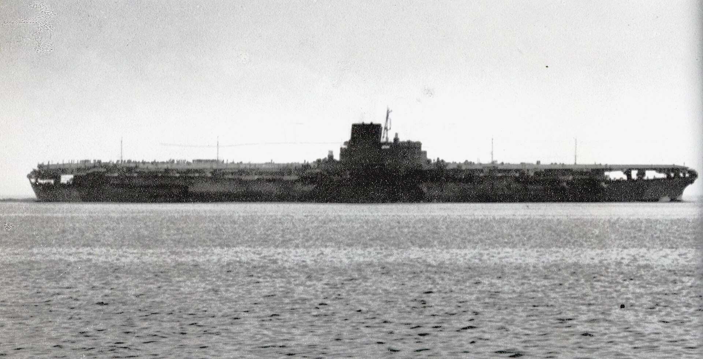
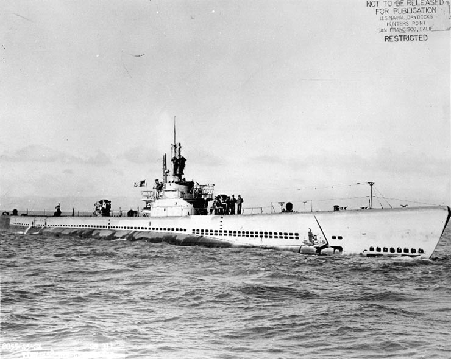
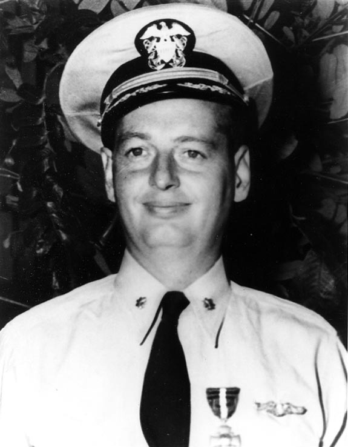
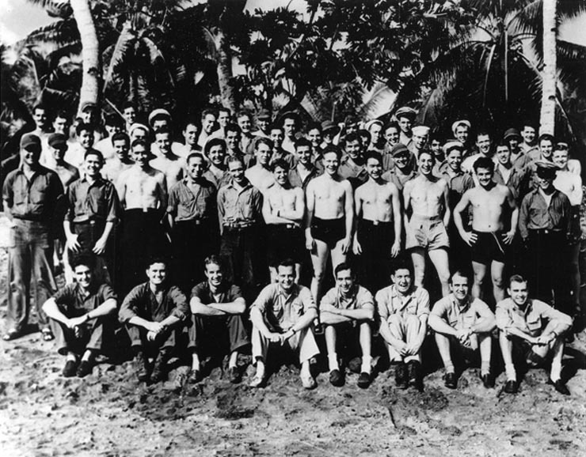

# The Night Chase for Shinano

*Preview line: He had asked to be relieved. Then came Shinano.*

*Shinano on sea trials in Tokyo Bay, 11 November 1944, eighteen days before she sank, in one of the very few photos of her ever taken. Photo by Hiroshi Arakawa, Kure Maritime History Science Museum PG070856, public domain.*

At 8:48 on the night of 28 November 1944, the radar aboard the submarine USS Archerfish picked up a contact south of Honshu, 24,700 yards away and moving fast. Within the hour her captain, Cmdr. Joseph Enright, knew what it was. He set it down in his patrol report in the flat language the Navy liked: "Identified target as aircraft carrier, base course 210, speed 20."

For most submarine captains, that would have been the moment of a career. For Enright it was something more. A year earlier he had been handed a carrier and lost it, and he had gone ashore and asked to be relieved of his command.

## The man who gave up his boat

Joseph Francis Enright was born in Minot, North Dakota, on 18 September 1910. He graduated from the Naval Academy in 1933, served three years in the battleship Maryland, and joined the submarine force in 1936.

In July 1943 he took command of the brand new submarine USS Dace. On her first war patrol that autumn he was sent an intelligence fix on the Japanese carrier Shokaku. He could not get into attack position, and the carrier passed by unharmed. The patrol lasted 49 days and sank nothing.

Back at Midway, Enright took the blame himself and asked to be relieved. Admiral Charles Lockwood agreed. Enright spent about half a year on shore duty at the Midway submarine base. Then he asked for another boat, and he got one: a rare second chance.

On 29 September 1944, at Pearl Harbor, he took command of USS Archerfish, a Balao class boat with a crew of about 81. A month later she sailed for her fifth war patrol, in the waters south of Honshu. Part of her job was lifeguard duty, standing by to rescue the crews of B-29s shot down on the raids against Tokyo.

*USS Archerfish off Hunter's Point, San Francisco, 5 June 1945, six months after the patrol. U.S. Navy photo, Naval Historical Center NH 96816, public domain.*

## A ship the Americans could not name

The carrier on Enright's radar had begun life as something else. Her keel was laid on 4 May 1940 in a new drydock at Yokosuka, as the third Yamato class battleship. After Japan lost four carriers at Midway in June 1942, the half built hull was redesigned as an aircraft carrier.

She was built in such secrecy that the Americans did not know what she was. In August 1944 U.S. codebreakers read a Japanese telegram assigning men to a new ship called Shinano, and because she was named for a river, they guessed she was a cruiser. Sources still disagree on her weight, from 59,000 tons standard in the postwar American count to 72,000 tons at full load. Either way, she was the heaviest carrier built until the 1950s.

On 1 November a B-29 photographed her moored outside Yokosuka harbor. That was enough. The navy decided to move her to Kure, the safer base in the Inland Sea, before her fitting out was finished. She was commissioned on 19 November under Capt. Toshio Abe, who had been in charge of her since August.

Abe asked for a few more days. He wanted more work finished and more time to train his crew. The request was refused: air raids on Yokosuka seemed close, and the Ohka suicide planes she would carry were wanted in the Philippines. Only eight of her twelve boilers were finished. She sailed on 28 November with six of them lit, three destroyers around her, roughly 2,500 people aboard, and 50 Ohka rocket bombs. With no air cover to be had, Abe made the run by night.

## The red light

Enright began a surface chase. At 10:50 p.m. the carrier switched on a red masthead light, ten seconds on, twenty off, ten on again. Fearing gunfire, Enright sent his lookouts below and watched for flashes. None came. The nearest escort, 6,100 yards off, did nothing. "Escort continued to ignore us," he wrote, and called his lookouts back up.

The escort was not ignoring him. Shinano's own lookouts had seen the surfaced submarine at 10:45. Abe told his destroyers to hold their fire. He reasoned that a lone submarine sitting in plain view was probably a decoy for a wolfpack, and he chose to turn away from it rather than go after it.

So the chase went on through the night. The carrier was about a knot faster than Archerfish at her best, but every zigzag gave the submarine a little ground. "His speed was about one knot in excess of our best, but his zig plan allowed us to pull ahead very slowly," Enright wrote. Then, at 11:30, an overheated turbine on one of Shinano's shafts forced her down to 18 knots.

Enright counted four escorts in the dark. There were really three.

## Six torpedoes

At 3:05 a.m. on 29 November the carrier turned toward him, and Enright dived about 11,700 yards ahead of her. One escort passed only 400 yards in front of the submarine without spotting it.

From 1,400 yards Archerfish fired all six bow tubes, Mark 14 torpedoes set to run at ten feet. Enright watched through the periscope. "Heard and observed first hit just inside stern near props and rudder," he logged. "Large ball of fire climbed his side." A second hit came about 50 yards forward of the first. Then he took the boat deep to get away from a destroyer, and his crew heard four more. He claimed all six. Japanese records count four, all on the starboard side.

Archerfish rode out 14 depth charges in twenty minutes, the closest perhaps 300 yards away. Then her sonar picked up hissing and breaking noises that went on for 47 minutes.

## A slow death

On the carrier, the damage looked manageable at first. At 3:34 Abe radioed: "Received a torpedo attack of 4 torpedoes." He kept up his speed and his course, which forced more water in. Shinano's compartments had never been air tested for leaks, as her executive officer said later, and the flooding spread through them.

By 6:00 a.m. she was listing 18 degrees and her boilers were shut down. By 7:20 she was dead in the water. Two destroyers took her in tow at 8:50, and the cables parted.

Abe ordered abandon ship at 10:18. At 10:57 Shinano rolled over to starboard and sank stern first, less than a day out of Yokosuka and ten days after she was commissioned. The captain of the destroyer Hamakaze radioed what he saw: "At 1057 she assumed a terrific list, turned over and sank."

Abe went down with her by his own choice, along with 1,435 officers, men and civilians. The destroyers pulled 1,080 people from the sea. Miles away and submerged, Archerfish logged a large distant explosion that morning. "Our target by all rights should have been down long ago," Enright wrote.

## The carrier nobody believed in

The Japanese navy kept the loss quiet. Survivors were held on the island of Mitsuko-jima in Kure Bay until January 1945, and a court of inquiry blamed no one in particular, concluding that a gamble had been taken with an unfinished ship, and lost.

At Pearl Harbor, U.S. naval intelligence doubted Enright's claim. No one knew such a ship existed. He had guessed his target was about 750 feet long; Shinano was about 872. In his report he hoped a reconnaissance plane over Yokohama might have a picture that could identify her. On 23 December the Pacific submarine command credited Archerfish with one carrier of 28,000 tons, less than half her real size. Even so, its endorsement called the sinking "an illustrious accomplishment for which the ARCHER-FISH deserves the greatest praise."

*Cmdr. Joseph F. Enright at Pearl Harbor, 5 March 1945, just after he was presented with the Navy Cross for sinking Shinano. U.S. Naval Historical Center photo NH 90520, courtesy of Capt. Joseph F. Enright, public domain.*

Only after the war did the full truth come out. In 1947 the joint Army and Navy assessment of Japanese losses credited Archerfish with sinking the aircraft carrier Shinano, 59,000 tons, on 29 November 1944. She remains the largest warship ever sunk by a submarine.

## Back to Dock No. 6

Enright received the Navy Cross. "After six hours of determined chase, he succeeded in bringing the submarine to a favorable attack position ahead," his citation reads. Archerfish received the Presidential Unit Citation for the patrol.

*Archerfish's crew ashore at Camp Dealey, Guam, on Christmas Day 1944, ten days after the patrol ended; Enright sits fourth from left in the front row. U.S. Naval Historical Center photo NH 90516, courtesy of Capt. Joseph F. Enright, public domain.*

Shinano's sisters did not last long either. Musashi had been sunk by American carrier planes in the Sibuyan Sea five weeks before, and Yamato went down in April 1945.

On 2 September 1945 Archerfish was one of 12 U.S. submarines in Tokyo Bay for the Japanese surrender. Around then Enright went to see Dock No. 6 at Yokosuka, where Shinano had been built.

He retired as a captain in 1963 and in 1987 published his own account, Shinano! The Sinking of Japan's Secret Supership, written with James W. Ryan. He died at his home in Fairfax, Virginia, on 20 July 2000, aged 89, and is buried at Arlington. The officer who once gave up his boat for failing to catch a carrier had caught the biggest one of all.

---

## Also this week

Each morning brought a new dispatch. Catch up on any you missed:

* No. 080, The Road of Life opens: [Read on X](https://x.com/ww2dispatches/status/2124518789572108761)
* No. 083, The flag over Strasbourg: [Read on X](https://x.com/ww2dispatches/status/2124881595211415967)
* No. 086, B-29s strike Tokyo from Saipan: [Read on X](https://x.com/ww2dispatches/status/2125244064987587041)
* No. 089, Kamikazes hit four carriers: [Read on X](https://x.com/ww2dispatches/status/2125606865727791256)
* No. 092, Butch O'Hare's last flight: [Read on X](https://x.com/ww2dispatches/status/2125969839931965773)
* No. 095, France sinks its own fleet: [Read on X](https://x.com/ww2dispatches/status/2126331816479007208)
* No. 098, The Big Three meet at Tehran: [Read on X](https://x.com/ww2dispatches)

---

## Sources

[USS Archer-Fish (SS-311), Report of Fifth War Patrol, with endorsements](https://catalog.archives.gov/id/139795814), 15 December 1944, World War II War Diaries, National Archives

[Anthony P. Tully, IJN Shinano: Tabular Record of Movement](https://www.combinedfleet.com/Shinano.htm), Combinedfleet.com

[Japanese Naval and Merchant Shipping Losses During World War II by All Causes, Chapter 3](https://www.ibiblio.org/hyperwar/Japan/IJN/JANAC-Losses/JANAC-Losses-3.html), Joint Army Navy Assessment Committee, 1947 (HyperWar)

[Navy Cross citation, Cmdr. Joseph F. Enright](https://homeofheroes.com/?p=109250), Home of Heroes

[Captain Joseph F. Enright, USN (1910 to 2000)](https://www.ibiblio.org/hyperwar/OnlineLibrary/photos/pers-us/uspers-e/j-enrigt.htm), Naval Historical Center, Online Library of Selected Images (HyperWar)

[USS Archerfish (SS-311), 1943 to 1968](https://www.ibiblio.org/hyperwar/OnlineLibrary/photos/sh-usn/usnsh-a/ss311.htm), Naval Historical Center, Online Library of Selected Images (HyperWar)

[Captain Joseph F. Enright, obituary](https://archive.navalsubleague.org/?p=3666), The New York Times, 26 July 2000, reprinted in The Submarine Review, Naval Submarine League

[Japanese aircraft carrier Shinano](https://en.wikipedia.org/wiki/Japanese_aircraft_carrier_Shinano), Wikipedia (citing Enright and Ryan, Shinano!, 1987, and Blair, Silent Victory)

---

Thank you for reading the Weekly Dispatch. Every Sunday we pick the most remarkable story from the week's dates and tell it in full.

*WW2 Dispatches*
